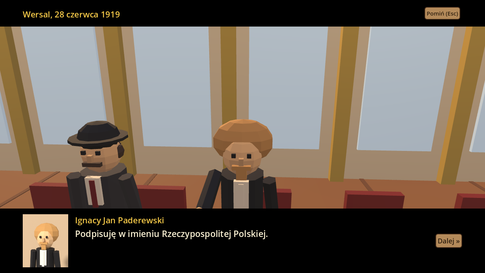
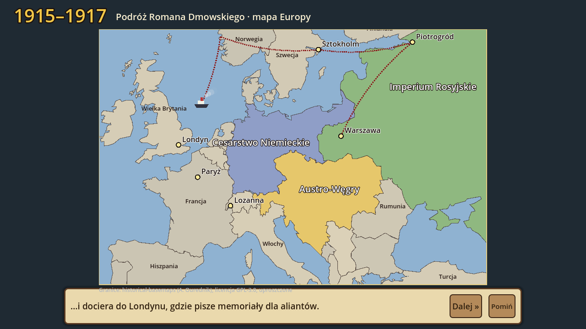

# Roman Dmowski. Droga do Wersalu 3D

Edukacyjna gra strategiczna 3D o odzyskaniu niepodległości przez Polskę (1914–1919) dla dzieci w wieku
**10–12 lat**, po polsku. Modele: **Blender**, silnik: **Godot 4.3**, plik wynikowy:
**`DmowskiDrogaDoWersalu3D.exe`** (Windows 10/11). Mechanika jak w grze `../zamosc3d/`.

## Kampanie

| Kampania | Miejsce i lata | Cele |
|---|---|---|
| I. Komitet w Warszawie | Warszawa, 1914–1915 | rozmowa z Maurycym Zamoyskim, kwatery, redakcja, komitet pomocy, Siedziba Komitetu Narodowego Polskiego |
| II. Dyplomata w Lozannie | Lozanna, 1915–1917 | biura informacyjne i redakcje, Siedziba KNP w Lozannie, poparcie aliantów |
| III. Błękitna Armia | Francja, 1917–1918 | rozmowa z gen. Hallerem, werbunek, obóz, szpital, Kwatera główna, 3 pozycje na froncie |
| IV. Konferencja w Paryżu | Paryż i Wersal, 1919 | Paderewski, przemówienie przed Radą Dziesięciu (29 I 1919), memoriały o Wielkopolsce, Pomorzu i Gdańsku, Górnym Śląsku, Warmii i Mazurach, rozmowa z Wilsonem; finał — traktat wersalski (28 VI 1919) |

Postacie: Roman Dmowski (bohater, z teczką memoriałów), Maurycy Zamoyski, gen. Józef Haller,
Ignacy Jan Paderewski, Georges Clemenceau, Woodrow Wilson, Józef Piłsudski (telegram z 11 listopada)
i Hanna — sekretarka Komitetu (postać fikcyjna).

**Nowości w tej wersji:**
- **Animowane postacie** — modele z Blendera mają ruchome ręce i nogi; postacie są większe i lepiej podpisane.
- **Żywe miasta** — przechodnie, tramwaj konny w Warszawie, dorożki i automobile, ptaki, dym z kominów,
  żołnierze Błękitnej Armii; własne oświetlenie każdej kampanii (deszcz i mgła na froncie w Szampanii,
  złote popołudnie w Paryżu).
- **Przerywniki filmowe 3D** — przemówienie przed Radą Dziesięciu (29 I 1919), Warszawa 11 listopada 1918
  i podpisanie traktatu w Sali Lustrzanej w Wersalu (28 VI 1919), z napisami i portretami.
- **Mini-gra „Przemówienie”** — 5 pytań delegatów; wybierasz najlepsze argumenty, a miernik
  „Przekonanie Rady” i 1–3 gwiazdki decydują o nagrodzie.
- **Wersja przeglądarkowa (HTML5)** — po scaleniu z gałęzią `main` strona GitHub Pages buduje grę
  i udostępnia ją pod adresem `…/dmowski3d/graj/` (bez instalowania EXE).

**Wstęp nauczyciela i karty postaci:**
- Po „Nowa gra” (i z menu tytułowego) **Pan Damian, nauczyciel historii**, prowadzi w klasie 3D krótki wstęp
  z lektorem: zabory, wybuch wojny, dwie drogi do niepodległości, cel gry i uczciwe spojrzenie na Dmowskiego.
- **Karty postaci** (Księga Wiedzy → „Karty postaci”) dla 7 postaci historycznych z gry: duża ilustracja
  z Blendera, daty i rola, 4 fakty z ikonami oraz ramka z ciekawostką. Karta odblokowuje się po spotkaniu
  postaci (+2 PW za poznanie), lektor czyta ją na głos. Hanna, postać fikcyjna, nie ma karty.

**Lektor, oś czasu i mapa Europy:**
- **Lektor** czyta po polsku kwestie postaci, wstępy, przerywniki, zagadki, karty Księgi i podpisy mapy
  (syntezator Piper: osobne głosy dla Dmowskiego, Hanny i Kronikarza). Klawisz **G** lub Menu włącza i wyłącza
  lektora. Nagrania powstają w GitHub Actions (`narzedzia/generuj_lektora.py`), więc ma je wersja na stronie
  i EXE z Actions.
- **Oś czasu 1914–1919** w Księdze Wiedzy (zakładka): 17 wydarzeń z Polski i świata, zaznaczone te
  z przebytych kampanii; przycisk otwiera pełną oś czasu klasy VII z tego repozytorium.
- **Mapa Europy między kampaniami:** pociąg i statek jadą trasą Warszawa → Piotrogród → Skandynawia → Londyn
  → Paryż → Lozanna, a w 1918 r. granice zaborców zmieniają się w mapę z odrodzoną Polską. Granice:
  projekt [historical-basemaps](https://github.com/aourednik/historical-basemaps) (licencja GPL-3.0,
  plik `godot/dane/LICENSE-mapa-europy-GPL3.txt`).

Mechaniki: 4 zasoby (fundusze, poparcie aliantów, prasa, ochotnicy), działacze do obsługi placówek,
**ekwipunek** (11 przedmiotów z działaniem), **Punkty Wiedzy** (24 karty Księgi Wiedzy, 23 zagadki, rangi
od Wolontariusza do Ojca Niepodległości), kompas do celu, mapa kampanii, zapis gry. Księga Wiedzy pokazuje
też rolę Piłsudskiego, Paderewskiego i powstańców oraz to, że część poglądów Dmowskiego jest dziś krytykowana.

## Jak otworzyć u siebie

- **Gra:** rozpakuj ZIP z EXE i uruchom `DmowskiDrogaDoWersalu3D.exe`.
- **Godot 4.3+:** *Importuj* → `dmowski3d/godot/project.godot` → F5.
- **Blender:** `blender -b -P blender/generuj_modele.py` (z folderu `dmowski3d`).
- **Antigravity:** otwórz folder `dmowski3d` — `AGENTS.md` opisuje strukturę i polecenia dla agenta.

Sterowanie: WASD — chodzenie, Q/R lub prawy przycisk myszy — obrót kamery, kółko — zoom, E — rozmowa,
LPM/PPM — postaw/anuluj, K — kompas, I — ekwipunek, L — Księga Wiedzy, H — pomoc, M — muzyka, F11 — pełny ekran.

Autotest: `godot --headless --path godot -- --samotest` (przejście 4 kampanii). Workflow
`.github/workflows/dmowski3d-exe.yml` buduje EXE dla Windows, uruchamia autotest i robi zrzuty ekranu.
