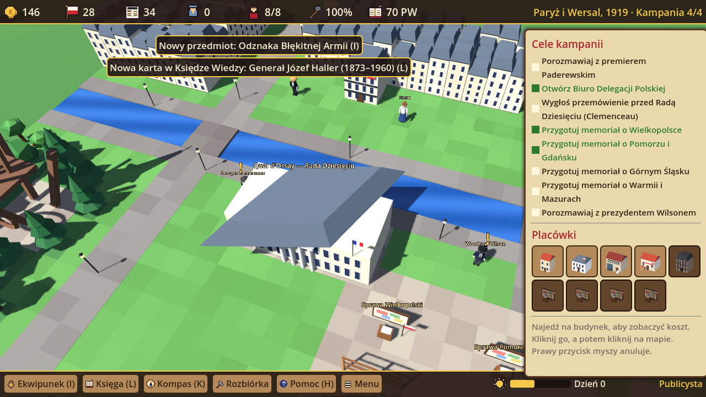

# Roman Dmowski. Droga do Wersalu 3D

Edukacyjna gra strategiczna 3D o odzyskaniu niepodległości przez Polskę (1914–1919) dla dzieci w wieku
**10–12 lat**, po polsku. Modele: **Blender**, silnik: **Godot 4.3**, plik wynikowy:
**`DmowskiDrogaDoWersalu3D.exe`** (Windows 10/11). Mechanika jak w grze `../zamosc3d/`.

## Kampanie

| Kampania | Miejsce i lata | Cele |
|---|---|---|
| I. Komitet w Warszawie | Warszawa, 1914–1915 | rozmowa z Maurycym Zamoyskim, kwatery, redakcja, komitet pomocy, Siedziba Komitetu Narodowego Polskiego |
| II. Dyplomata w Lozannie | Lozanna, 1915–1917 | biura informacyjne i redakcje, Siedziba KNP w Lozannie, poparcie aliantów |
| III. Błękitna Armia | Francja, 1917–1918 | rozmowa z gen. Hallerem, werbunek, obóz, szpital, Kwatera główna, 3 pozycje na froncie |
| IV. Konferencja w Paryżu | Paryż i Wersal, 1919 | Paderewski, przemówienie przed Radą Dziesięciu (29 I 1919), memoriały o Wielkopolsce, Pomorzu i Gdańsku, Górnym Śląsku, Warmii i Mazurach, rozmowa z Wilsonem; finał — traktat wersalski (28 VI 1919) |

Postacie: Roman Dmowski (bohater, z teczką memoriałów), Maurycy Zamoyski, gen. Józef Haller,
Ignacy Jan Paderewski, Georges Clemenceau, Woodrow Wilson, Józef Piłsudski (telegram z 11 listopada)
i Hanna — sekretarka Komitetu (postać fikcyjna).

Mechaniki: 4 zasoby (fundusze, poparcie aliantów, prasa, ochotnicy), działacze do obsługi placówek,
**ekwipunek** (11 przedmiotów z działaniem), **Punkty Wiedzy** (24 karty Księgi Wiedzy, 23 zagadki, rangi
od Wolontariusza do Ojca Niepodległości), kompas do celu, mapa kampanii, zapis gry. Księga Wiedzy pokazuje
też rolę Piłsudskiego, Paderewskiego i powstańców oraz to, że część poglądów Dmowskiego jest dziś krytykowana.

## Jak otworzyć u siebie

- **Gra:** rozpakuj ZIP z EXE i uruchom `DmowskiDrogaDoWersalu3D.exe`.
- **Godot 4.3+:** *Importuj* → `dmowski3d/godot/project.godot` → F5.
- **Blender:** `blender -b -P blender/generuj_modele.py` (z folderu `dmowski3d`).
- **Antigravity:** otwórz folder `dmowski3d` — `AGENTS.md` opisuje strukturę i polecenia dla agenta.

Sterowanie: WASD — chodzenie, Q/R lub prawy przycisk myszy — obrót kamery, kółko — zoom, E — rozmowa,
LPM/PPM — postaw/anuluj, K — kompas, I — ekwipunek, L — Księga Wiedzy, H — pomoc, M — muzyka, F11 — pełny ekran.

Autotest: `godot --headless --path godot -- --samotest` (przejście 4 kampanii). Workflow
`.github/workflows/dmowski3d-exe.yml` buduje EXE dla Windows, uruchamia autotest i robi zrzuty ekranu.
