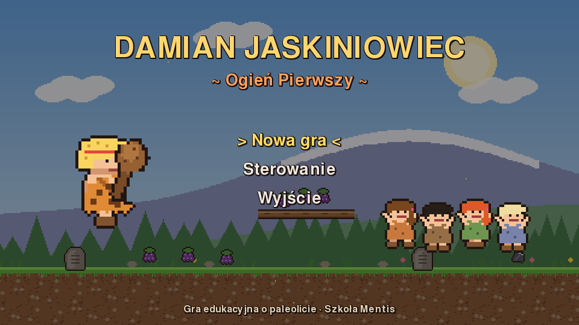
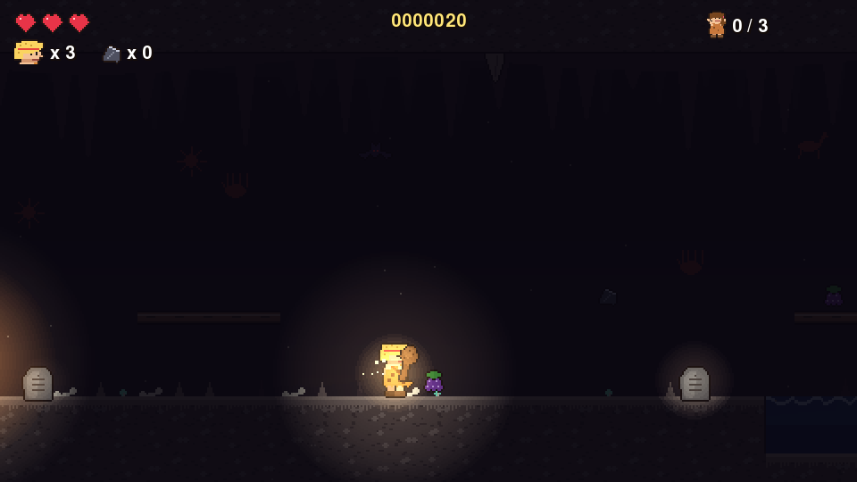
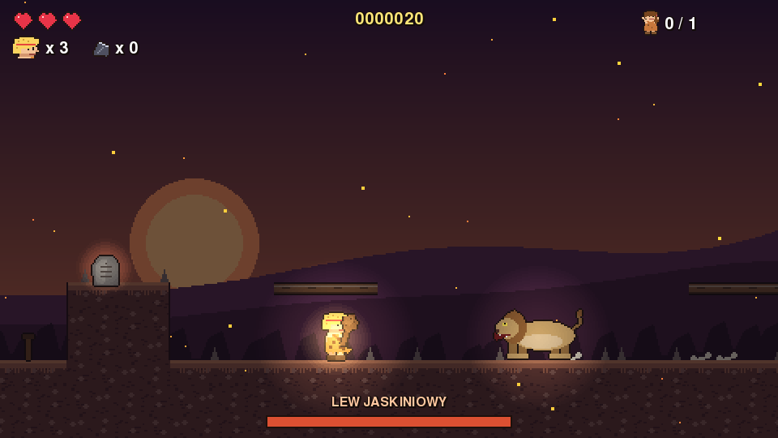

# Damian Jaskiniowiec: Ogień Pierwszy

Edukacyjna platformówka 2D o paleolicie dla Windows 10/11. Nauczyciel Damian, jaskiniowiec
w skórze, wędruje przez epokę lodowcową, odnajduje dzieci z plemienia Mentis i uczy je
przetrwania. Na końcu musi odzyskać Ogień Pierwszy z legowiska lwa jaskiniowego.

**Pobierz EXE:** [DamianJaskiniowiec.exe](https://github.com/adscisel-alt/gry-historyczne/releases/download/jaskiniowiec-latest/DamianJaskiniowiec.exe)
(bez instalacji, uruchamiasz dwuklikiem; przy ostrzeżeniu SmartScreen kliknij „Więcej informacji → Uruchom mimo to”).



## Rozdziały
1. **Dolina Wisły**: samouczek, rzeka z kłodami, pierwsza zagadka z głazem i wrotami.
2. **Lodowe Wzgórza**: śliski lód, spadające sople, wilki, przejażdżka na grzbiecie mamuta nad kolcami.
3. **Jaskinia Ciemna**: widzisz tylko to, co oświetla pochodnia. Nietoperze, świecące oczy w mroku
   i zagadka runiczna: kolejność zdradza malowidło naskalne.
4. **Legowisko Lwa**: przepaście i walka z lwem jaskiniowym. Nie da się go pokonać wprost: trzeba
   go zwabić na skałę, żeby się oszołomił.

Każde dziecko zadaje pytanie o życie w paleolicie (krzemień, łowiectwo i zbieractwo, koczownictwo, ubrania
ze skór, igły z kości, mamuty, rozpalanie ognia, malarstwo naskalne, bumerang z Jaskini Obłazowej).
Za złą odpowiedź nie ma kary. Dziecko podpowiada, a po dobrej odpowiedzi gra wyjaśnia, jak było naprawdę.




## Sterowanie
| Klawisz | Akcja |
|---|---|
| ← → / A D | chodzenie |
| Spacja / W / ↑ | skok (przytrzymaj = wyżej) |
| ↓ + skok | zeskok z kłody |
| X / J / Ctrl | maczuga |
| C / K | rzut krzemieniem |
| E / Enter | rozmowa, czytanie kamieni, oglądanie malowideł |
| R | ustaw głazy od nowa |
| Esc | pauza · F11 pełny ekran · M dźwięk |

Działa też pad. Postęp zapisuje się po każdym rozdziale (`%APPDATA%\DamianJaskiniowiec`).

## Uruchamianie ze źródeł
```
pip install pygame-ce
python gra.py
```
Cała grafika, muzyka i efekty dźwiękowe są generowane w kodzie (`grafika.py`, `dzwiek.py`),
mapy i pytania są w `poziomy.py`. Plik EXE buduje workflow `.github/workflows/jaskiniowiec-exe.yml`
(PyInstaller na `windows-latest`) i publikuje go w wydaniu `jaskiniowiec-latest`.
Test: `python test_gry.py`.
