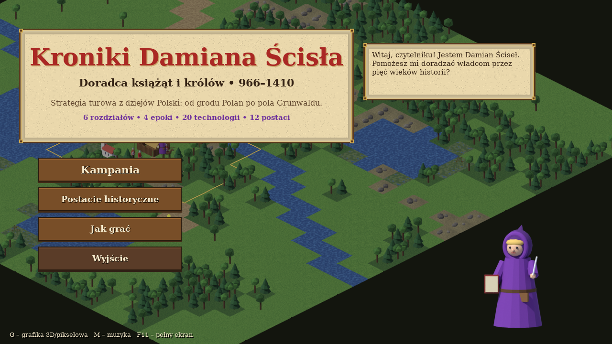
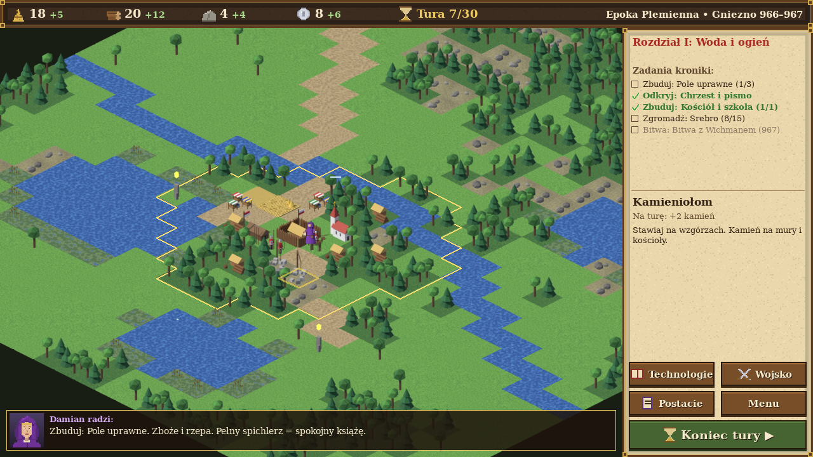
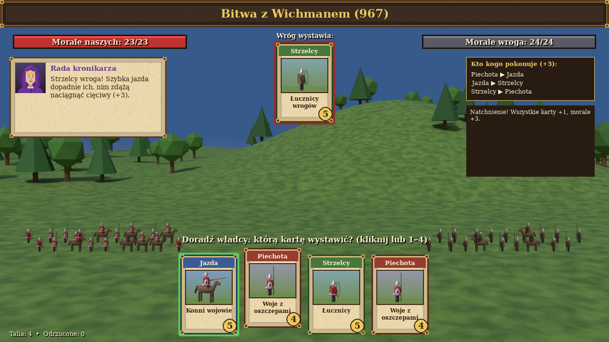
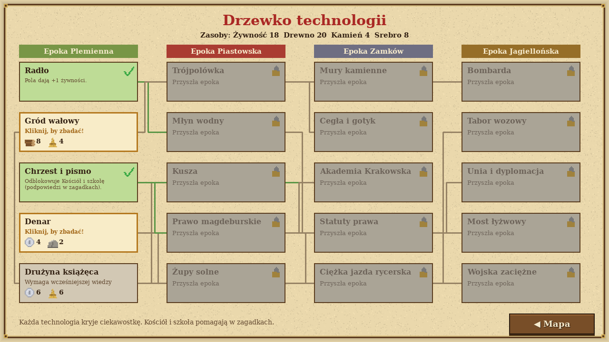

# Kroniki Damiana Ścisła – Doradca książąt i królów (966–1410)

Turowa strategia edukacyjna z historii Polski dla uczniów w wieku 10–14 lat – **na Windows (EXE) i w przeglądarce**.
Grafika to izometryczne **prerenderowane 3D**, tak jak w strategiach z lat 90. (Age of Empires II też miało
sprite'y wyrenderowane z modeli 3D). Wszystko – kafle terenu, drzewa, budynki, obozy, jednostki z klatkami marszu,
popiersia 16 postaci, tła bitew i przerywniki filmowe – modeluje i renderuje skrypt **Blendera**
`tools/blender/render_sprites.py` (ponad 220 obrazów w `assets/3d/`). Klawisz **G** przełącza na alternatywną
grafikę pikselową rysowaną kodem. Muzyka (5 motywów: menu i 4 epoki) i efekty są syntetyzowane kodem
(`tools/make_audio.py`), a **lektor** czyta kroniki polskim głosem syntezatora Piper (`tools/make_voice.py`).

Gracz jest **Damianem Ścisłem** – wędrownym kronikarzem i doradcą w fioletowym kapturze. Nie dowodzi armią
bezpośrednio: doradza władcy, co zbudować, jaką wiedzę zdobyć i którą siłę wystawić w bitwie.






## Kampania – 9 rozdziałów (6 głównych + 3 dodatkowe), 4 epoki

| Rok | Epoka | Rozdział | Cel |
|-----|-------|----------|-----|
| 966–967 | Plemienna | Gniezno – „Woda i ogień” | chrzest i pismo, bitwa z Wichmanem |
| 1000 | Plemienna | *dodatkowy:* Zjazd gnieźnieński | uczta dla Ottona III, arcybiskupstwo |
| 1109–1138 | Piastowska | *dodatkowy:* Krzywousty i obrona Głogowa | oblężenie przez cesarza Henryka V |
| 1241 | Piastowska | Legnica – „Burza ze Wschodu” | oblężenie: palisady, zapasy, odliczanie tur |
| 1257 | Piastowska | Kraków – „Miasto z prawem” | lokacja, targi, żupy solne |
| 1311–1320 | Zamków | *dodatkowy:* Korona Łokietka | bunt wójta Alberta, koronacja |
| 1331–1333 | Zamków | Płowce – „Mała postura, wielkie serce” | bitwa pod Płowcami, zamek Kazimierza |
| 1384–1386 | Jagiellońska | Krewo – „Korona i dwa narody” | dyplomacja, unia polsko-litewska |
| 1410 | Jagiellońska | Grunwald – „Dwa nagie miecze” | most łyżwowy, zaopatrzenie, wielka bitwa |

Każdy rozdział zaczyna się kroniką czytaną przez lektora, ma mapę 30×30 kafli z prawdziwą geografią
(Wisła pod Wawelem, Gopło, Kaczawa, Odra, Jezioro Lednickie…) z podpisami i różą wiatrów, zabytki
z ciekawostkami, wydarzenia fabularne z decyzjami, a przed bitwą finałową – przerywnik filmowy.

## Mechaniki

- **4 zasoby**, 10 typów budynków, granice rosnące z każdą budową; każdy kolejny budynek tego samego
  typu kosztuje o 25% więcej (koszt krańcowy). **Utrzymanie wojska**: każdy oddział ponad podstawową
  talię zjada 1 żywności na turę, a głód oznacza dezercję.
- **Aktywny wróg**: co kilka tur z obozu wyrusza zagon, maszeruje ku grodowi i pali budynki po drodze.
  Można go przechwycić, a palisady i zamki go odpierają.
- **Drzewko 20 technologii** – każdą zdobywa się zagadką historyczną; po odkryciu pojawia się ciekawostka.
- **Bitwy kartami**: pytanie z epoki (pula **152 pytań** bez powtórek), potem wróg wystawia jedną z dwóch
  kart – jedną widać, druga jest zakryta. Piechota ▶ Jazda ▶ Strzelcy ▶ Piechota (+3).
  **Dowódca rozdziału** daje premię, a **taktyki historyczne** (Posiłki czeskie, Wycieczka z grodu,
  Mgła nad Płowcami, Bogurodzica, Pozorowany odwrót…) można użyć raz w bitwie.
- **Poziomy trudności**: Łatwy (10–11 lat, podpowiedzi), Normalny, Trudny (13–14 lat).
- **Zdarzenia losowe** z lekcjami ekonomii: zaraza, najazd, poselstwo, susza, jarmark, pożar, urodzaj…
- **15 postaci historycznych** z popiersiami 3D, życiorysami i ciekawostkami oraz **encyklopedia kronikarza**:
  78 haseł (pojęcia, miejsca, wynalazki, taktyki) odblokowywanych w trakcie gry.
- **Zapis w dowolnym momencie** (autozapis co turę, „Kontynuuj” w menu).
- **Dziennik nauki** dla ucznia i nauczyciela: pytania do powtórki z poprawnymi odpowiedziami, wyniki
  w każdym rozdziale, **dyplom do druku** (PNG A4 z imieniem) i **eksport wyników do CSV**.

Sterowanie: mysz; strzałki/WASD lub prawy przycisk myszy – przesuwanie mapy; C – powrót do grodu;
Spacja – koniec tury; T/W/K – technologie/wojsko/encyklopedia; G – grafika 3D/pikselowa; M – muzyka;
F11 – pełny ekran.

## Gra w przeglądarce

Wersję web buduje [pygbag](https://pypi.org/project/pygbag/) (Python → WebAssembly). Po scaleniu do gałęzi
`main` workflow `pages.yml` publikuje ją pod adresem `…/gry-historyczne/kroniki-damiana-scisla/graj/`.
Workflow `kroniki-web.yml` buduje ją przy każdej zmianie i sprawdza w Chromium (Playwright), czy menu
się rysuje. Postęp zapisuje się w pamięci przeglądarki (localStorage).

Przycisk **„Nowa kronika (wyczyść postęp)”** w menu głównym usuwa postęp (np. dla kolejnego ucznia
na tym samym komputerze); ustawienia lektora, grafiki i trudności zostają.

## Pobranie EXE

Plik `KronikiDamianaScisla.exe` buduje GitHub Actions (`.github/workflows/kroniki-exe.yml`) na Windowsie:
zakładka **Actions → „Kroniki Damiana Ścisła – Windows EXE” → Artifacts**. Wypchnięcie tagu `kroniki-v1.0`
publikuje też wydanie (Release) z plikiem EXE.

## Uruchomienie ze źródeł / samodzielna kompilacja

```bat
python -m pip install -r requirements.txt
python main.py
build_exe.bat
```

Gotowy plik: `dist\KronikiDamianaScisla.exe` (jeden plik, ok. 30 MB, bez instalacji).

Testy i narzędzia:

- `python tests/bot_kampania.py 3` – bot przechodzi całą kampanię (test integracyjny bez okna),
- `python main.py --screenshots zrzuty` – zapisuje zrzuty kluczowych ekranów,
- `python tools/make_icon.py` – generuje ikonę `assets/icon.ico`,
- `python tools/make_audio.py` – syntetyzuje dźwięki i muzykę do `assets/audio/` (wymaga ffmpeg),
- `python tools/make_voice.py` – nagrania lektora do `assets/voice/` (wymaga `pip install piper-tts`,
  ffmpeg i dostępu do Hugging Face; w GitHub Actions dzieje się to automatycznie),
- `bash tools/build_web.sh` – wersja przeglądarkowa (pygbag),
- `python tools/blender/render_sprites.py` – modeluje i renderuje grafikę 3D (wymaga `pip install bpy`,
  czyli Blendera 5.x jako modułu Pythona 3.13; ok. 2 min na 4 rdzeniach CPU, silnik Cycles). Można też
  `blender -b -P tools/blender/render_sprites.py`. Opcja `--only unit` renderuje tylko wybraną grupę.

### Jak powstaje grafika 3D

Każdy model składa się z prymitywów Blendera (sześciany, walce, stożki, sfery) z materiałami
proceduralnymi (szum i fale → rampa kolorów + wypukłość). Kamera ortograficzna ma obrót 60°/45°,
więc kwadratowy kafel 1×1 rzutuje się na romb 64×32 px – dokładnie siatkę mapy gry. Punkt zaczepienia
każdego sprite'a (środek kafla, stopy postaci) ustawiany jest przesunięciem kamery, dzięki czemu
rendery pasują do silnika gry bez ręcznego dopasowywania.

Czcionka: DejaVu Serif (licencja w `assets/fonts/LICENSE-DejaVu.txt`).
