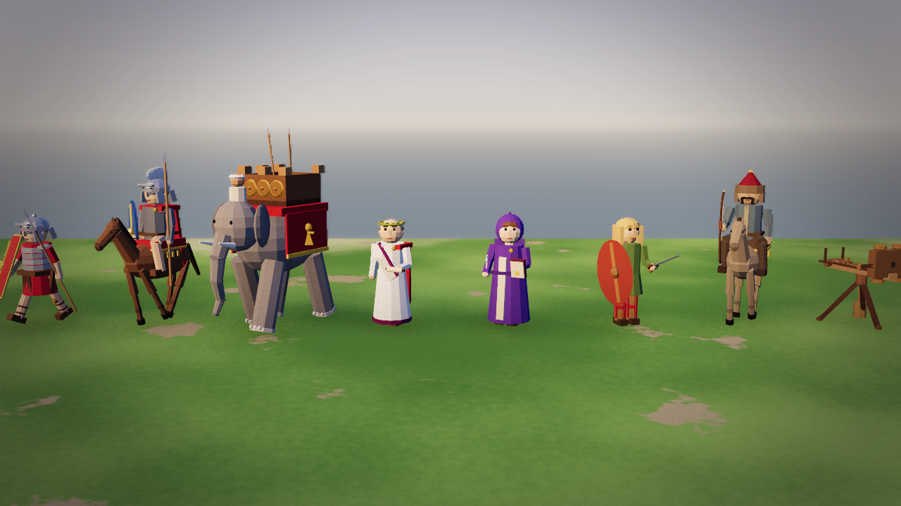
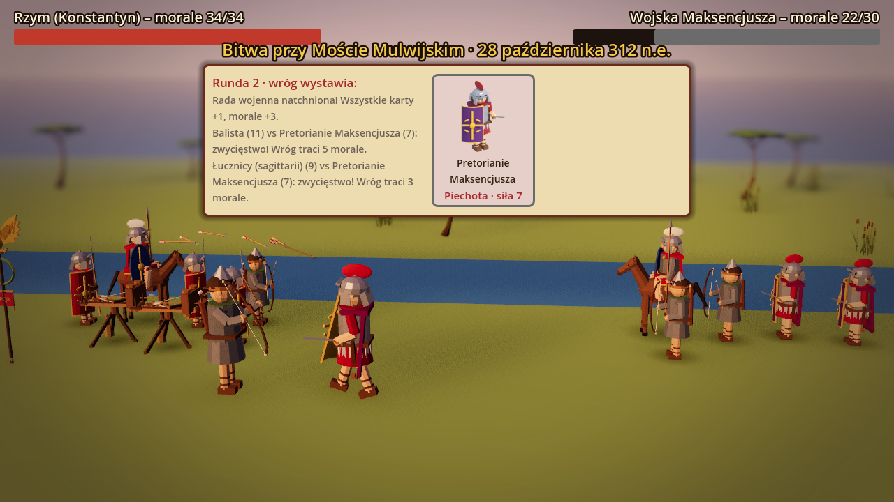
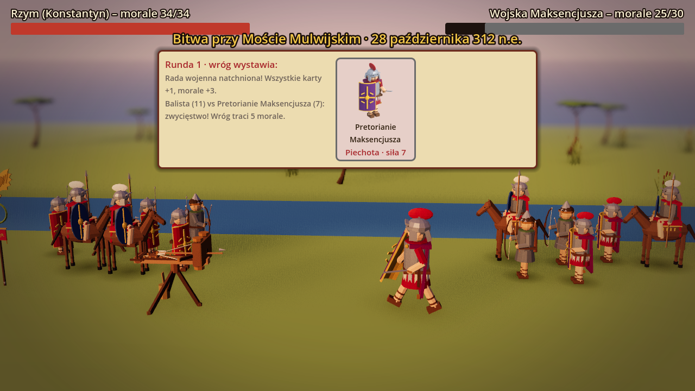
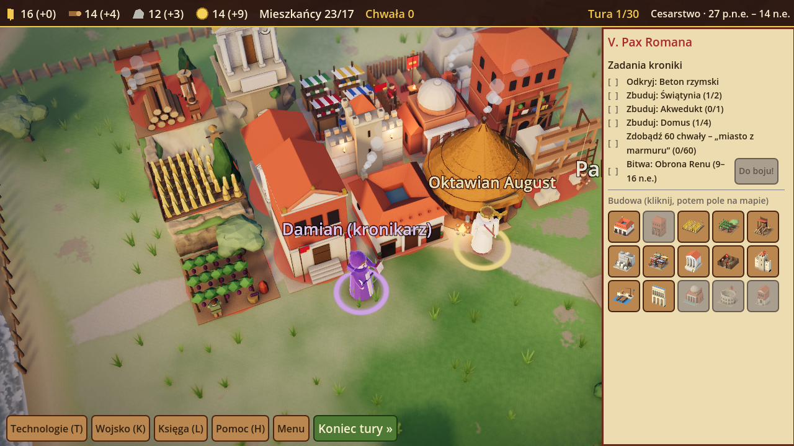
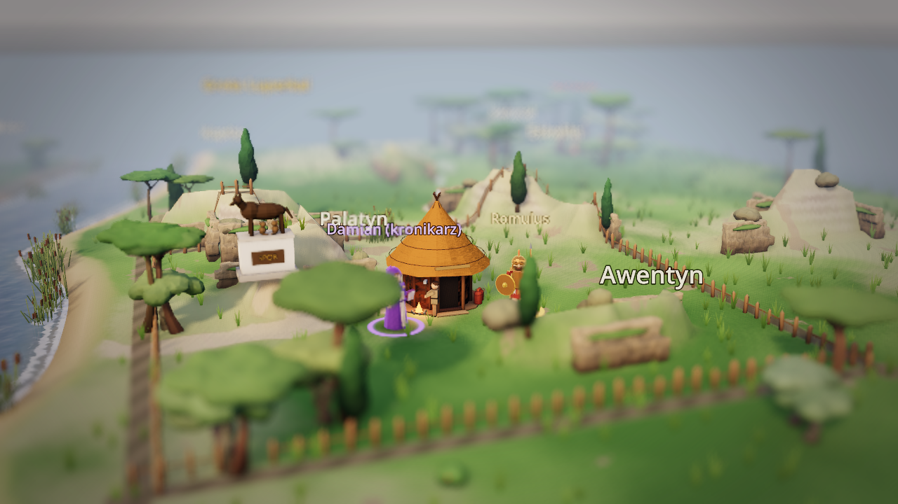
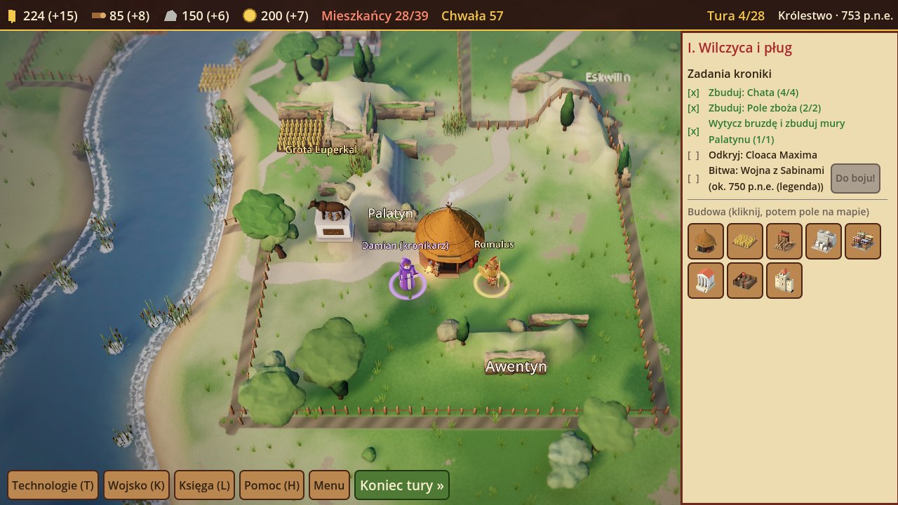
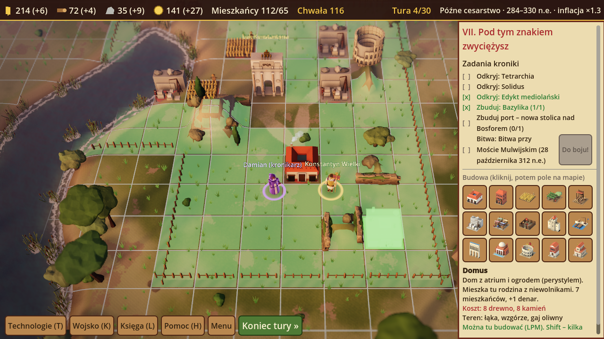
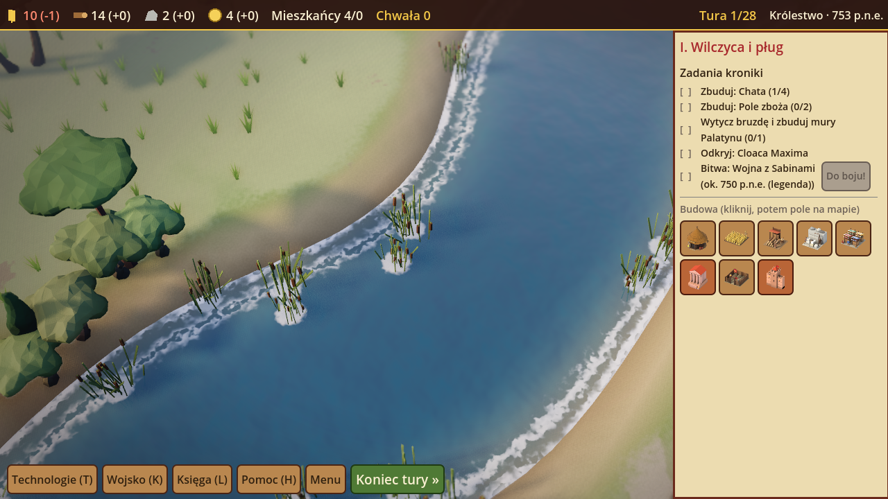
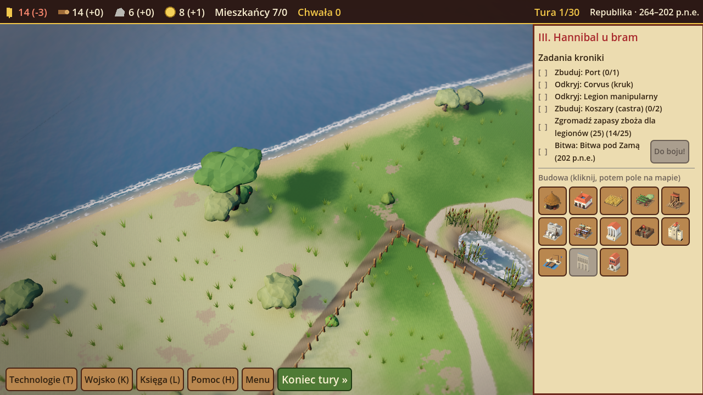

# Roman Empire — od narodzin przez rozkwit aż po upadek

**Kroniki Damiana Ścisła, część III.** Edukacyjna strategia turowa 3D o starożytnym Rzymie (753 p.n.e. – 476 n.e.)
dla uczniów w wieku **10–14 lat**, po polsku. Modele: **Blender** (skrypt Pythona), silnik: **Godot 4.3**.
Gra działa **w przeglądarce** (eksport HTML5) i jako **`RomanEmpire3D.exe`** na Windows.

- **Rozgrywka jak w „Kronikach Damiana Ścisła”**: mapa z kafli, tury, 4 zasoby (zboże, drewno, kamień, denary),
  budynki poszerzające granice, technologie zdobywane zagadką, bitwy kartami z pytaniem rady wojennej, zagony
  wroga z obozów, kronikarz Damian w fioletowym płaszczu jako doradca, lektor.
- **Mapy jak w „Roman Dmowski. Droga do Wersalu 3D”**: przed każdym rozdziałem animowana mapa basenu Morza
  Śródziemnego z prawdziwymi granicami epoki (historical-basemaps), trasą wyprawy (legion lądem, galera morzem)
  i przejściem granic, np. od Republiki 200 p.n.e. do imperium Trajana.
- **Tryb wieloosobowy**: 2–4 graczy jako rody (Juliusze, Korneliusze, Klaudiusze, Fabiusze) – przy jednym komputerze
  albo **online** (pokoje z 4-literowym kodem).


## Oświetlenie

Scena ma `WorldEnvironment` z niebem proceduralnym (`ProceduralSky`), które jest źródłem światła otoczenia i odbić,
tonemapping **ACES**, **SSAO** (cień w miejscach styku obiektów z ziemią), lekki **glow** (miękki blask) i delikatną mgłę
w chłodnym odcieniu. Mgła jest **odległościowa** (zaczyna się tuż za punktem, na który patrzy kamera, i rośnie z odległością),
a **głębia ostrości w stylu tilt-shift** zostawia ostry pas w środku kadru i miękko rozmywa bliższe i dalsze plany –
plansza wygląda jak prawdziwa makieta. W bitwie pas ostrości obejmuje oba szyki, a rozmywa się tylko tło. Słońce stoi nisko (22–34° zależnie od epoki), ma ciepłą barwę i rzuca **miękkie cienie** (PCSS i rozmycie,
4 kaskady). Każda epoka ma własny klimat – od jasnego południa Królestwa po złoty zmierzch późnego cesarstwa.

- **Komputer (EXE):** renderer **Forward+** – pełne SSAO, glow, cienie PCSS i prawdziwy DOF kamery. Bez Vulkana/D3D12 gra sama przełącza się
  na OpenGL.
- **Przeglądarka:** renderer **GL Compatibility** (WebGL 2), w którym Godot nie ma SSAO. Styk z ziemią przyciemniają
  tam miękkie cienie kontaktowe pod budynkami, postaciami i oddziałami, DOF zastępuje shader tilt-shift na ekranie
  (rozmycie górnego i dolnego pasa), a ekspozycja i gęstość mgły jest dobrana tak, żeby scena
  wyglądała podobnie jak w Forward+.

## Postacie i jednostki – detale i animacje

- **Detale**: pochwa z gladiusem i sztylet (pugio) przy pasie legionistów i pretorianów, sakiewki przy tunikach,
  złoty łańcuch cesarzy, gęsie pióro kronikarza Damiana, peleryny z obszyciem; koń z uzdą, kopytami, stawami
  i frędzlami czapraka; słoń z paznokciami i fałdami skóry na trąbie.
- **Ruchome części** (Blender → Godot): głowa, peleryna, ręce i nogi postaci; nogi, głowa, ogon konia i jeździec;
  nogi, trąba, uszy i ogon słonia.
- **Animacje** (`animuj_postac()` w `gra.gd`):
  - *spoczynek* – oddech, rozglądanie się, peleryna falująca na wietrze, koń skubiący trawę i machający ogonem,
    słoń wachlujący uszami i kołyszący trąbą, Damian piszący piórem w kronice;
  - *marsz* – kroki z wymachem rąk, kiwanie głową, rozwiana peleryna; jazda w galopie z jeźdźcem unoszącym się
    w siodle; ciężki krok słonia;
  - *atak* (bitwa) – oddziały biegną do starcia, potem zamach i cios mieczem z wysuniętą tarczą.

- **Balista** (skorpion) ma ruchome ramiona w wiązkach ścięgien, suwak z zaczepem, bełt i kołowrót z korbami;
  cięciwy gra liczy w każdej klatce między końcami ramion a zaczepem. W bitwie balista nie biegnie do starcia –
  zostaje z tyłu: ramiona strzelają do przodu, bełt leci łukiem w nadbiegającego wroga, potem suwak jedzie
  po cięciwę, kołowrót ściąga ją z powrotem, ramiona się napinają i na łożu pojawia się nowy bełt.

- **Łucznicy** (sagittarii, łucznicy daccy i Maksencjusza, konni łucznicy Hunów z kartą „Deszcz strzał”) też
  strzelają z miejsca – po obu stronach. Łucznik wysuwa łuk, prawą dłonią naciąga cięciwę z nałożoną strzałą,
  celuje i zwalnia; strzała leci wysokim łukiem w przeciwnika, a szereg łuczników wypuszcza salwę – chybione
  strzały wbijają się w ziemię wokół celu. Cięciwa i nałożona strzała są rysowane w grze i podążają za dłonią.





## Budynki – detale i animacje

Każdy budynek ma dodatkowe detale i „żyje” (`ZYCIE` w `blender/generuj_modele.py`, animacje w `_animuj_budynki()`):

| Budynek | Detale i ruch |
|---|---|
| chata | dym ze strzechy, palenisko z migoczącym ogniem, płot z wikliny, rzemieślnik z młotkiem |
| domus | dym z komina kuchni, woda w impluvium, donice z oleandrem |
| insula | dym z komina, pranie łopoczące na balkonie, markizy sklepików |
| pole | kłosy falujące rzędami na wietrze, strach na wróble |
| winnica | winiarz zbierający winogrona do kosza |
| obóz drwali | tracz piłujący belkę, dym z ogniska |
| kamieniołom | obracające się koło dźwigu, kamieniarz z kilofem i ciosacz z młotem |
| targ | kołyszące się markizy straganów, fontanna z wodą i kroplami, kupiec |
| świątynia | ogień na ołtarzu (ze światłem) i dym kadzidła |
| koszary | łopoczący sztandar, legionista ćwiczący mieczem przy palu, pochodnia |
| mury | flaga na baszcie, pochodnie przy blankach |
| port | kołysząca się łódź, obracający się żuraw z ładunkiem, falująca woda, flaga |
| akwedukt | woda płynąca kanałem na szczycie |
| termy | dym z pieca (praefurnium), para nad basenem, woda w basenie |
| amfiteatr | flagi velarium na szczycie |
| kuria | dwie flagi SPQR przed wejściem |
| bazylika | migoczące lampy przy wejściu |
| budowa | murarz z młotem, pomocnik, kołyszący się ładunek na linie |

Nowo ukończony budynek wyrasta z ziemi (z kurzem), a rusztowanie „wskakuje” na plac budowy. Ruchome części to
osobne węzły z modeli Blendera o nazwach `anim_obrot_*`, `anim_kolys_*`, `anim_pila_*`, `anim_mlot_*`, `anim_ogien_*`,
`anim_woda_*`, `anim_lodz`; puste punkty `dym_*` wyznaczają miejsca dymu i fontann.



## Modele i teren (Blender)

- **Wzgórza jako rzeźba terenu**: Palatyn, Awentyn, Eskwilin i pozostałe wzgórza to skośne, trawiaste stoki
  (heightmapa `wys_punkt()` w `gra.gd`) o zaokrąglonych szczytach. Każde wzgórze ma własną wysokość (większe są wyższe)
  i falującą wierzchowinę. Pokrywa je ta sama tekstura terenu co resztę mapy, tylko na szczytach trawa jest suchsza,
  płowa i z większą ilością gołej ziemi. W kilku miejscach (zawsze nad wodą, poza tym na ok. 1/5 krawędzi) stok
  przechodzi w skalne urwisko z modułów `klif_0..3` dopasowanych do wysokości stoku.


- **Fazowane krawędzie i wypalony AO**: budynki, zabytki i obozy mają bevel (krawędzie łapią światło), a kolor
  z ambient occlusion jest wypalony do tekstury (Cycles, Smart UV). Drzewa, krzewy, skały i trzciny mają AO
  wypalony w kolorach wierzchołków.
- **Warianty z Geometry Nodes**: po 4 wersje pinii, cyprysów, oliwek, dębów, krzewów, skał, trzcin i klifów
  (inne ziarno budowy + deformacja szumem 4D i nierówna skala w węźle Geometry Nodes). Godot losuje wariant,
  obrót, skalę i pochylenie każdego egzemplarza.
- **Roślinność Lacjum**: w Italii rosną pinie o parasolowatych koronach, cyprysy i oliwki (bez drzew liściastych),
  nad Tybrem kępy trzciny z kolbami w płytkiej wodzie; w Afryce oliwki i pinie; dęby tylko w Galii, Dacji i na północy.
- **Chata z Palatynu**: ściana z plecionki oblepionej gliną i strzecha z warstw słomy (obie z normal mapami),
  żerdzie dachu krzyżujące się nad kalenicą, powrósła, a wokół wydeptana ziemia, płot, amfory, ławka, drewno
  i palenisko.
- **Bohaterowie** (Damian i dowódca rozdziału) są większe, mają ciepłą poświatę sylwetki, kolorowy krąg pod
  stopami i wyraźną animację spoczynku: przenoszenie ciężaru, rozglądanie się, co kilka sekund gest (Romulus
  i wodzowie unoszą broń, Damian podnosi kronikę), Damian pisze piórem.



## Teren

Plansza nie jest już szachownicą kolorowych pól. Wierzch terenu rysuje shader (`_material_terenu()` w `gra.gd`):
jedna tekstura trawy w dwóch odcieniach z drobnymi „źdźbłami” i rzadkie plamy ziemi, mieszane szumem
(tekstury szumu generowane w grze, więc działa i w przeglądarce). Typy terenu – drogi, plaże,
wzgórza, bagna, lasy, gaje oliwne – wtapiają się miękko: kolor i udział trawy liczone są w narożnikach pól jako
średnia sąsiadów, a granicę dodatkowo szarpie szum. W późnym cesarstwie trawa jest bardziej sucha i płowa.

**Trawa, cienie, głębia, granica osady.** Drobny wzór trawy ma niski kontrast i dwie skale (bez widocznego
powtarzania), a wielkoskalowy szum maluje plamy suchszej, żółtawej trawy. Na łąkach i wzgórzach rosną rzadkie kępki
trawy 3D (MultiMesh, bez wody, ścieżek, stromych stoków i pól z budynkami). Cienie są jaśniejsze, a po mapie powoli
przesuwają się miękkie cienie chmur. Chłodna mgła odległościowa i delikatna winieta zamykają kadr. Granica osady
to nie płaska linia, tylko bruzda pomerium (zaorana ziemia z wałem – jak bruzda Romulusa wokół Palatynu) i niski
płotek z palików i żerdzi po wewnętrznej stronie (w grze wieloosobowej w odcieniu rodu).

**Ścieżki prowadzą dokądś.** Sieć wyznacza algorytm Dijkstry na siatce terenu (0,5 m): stoki i szczyty wzgórz
są kosztowne, woda i góry nieprzekraczalne, lasy i bagna omijane, a istniejące ścieżki chętnie wykorzystywane – więc
drogi same biegną dolinami między wzgórzami. Na start powstają ścieżki od siedziby do brzegu rzeki lub morza,
do pobliskich zabytków (np. Groty Luperkal), w stronę obozu wroga i między siedzibami graczy. Każdy nowy budynek
(już w chwili rozpoczęcia budowy) dostaje odnogę do najbliższej ścieżki. Trasy są wygładzane (Chaikin), lekko
się wiją, a wokół wydeptanego pasa trawa jest przerzedzona (`_sciezki_od_nowa()`, `_sciezki_dorysuj()` w `gra.gd`).

**Siatka pól pojawia się tylko w trybie budowy** – jako półprzezroczysta nakładka, w której pola, na których
można postawić wybrany budynek, świecą na zielono.



## Drzewa

Drzewa zostają low-poly, ale mają charakterystyczne sylwetki (`blender/generuj_modele.py`, sekcja „drzewa”):

- **Korona z kilku brył**: 3–7 brył różnej wielkości, przesuniętych asymetrycznie, zlanych w jedną voxel-remeshem,
  z lekkim displace szumem i decymacją do ok. 200–300 ścian.
- **Pień z charakterem**: wygięty, zwężający się ku górze, poszerzony przy ziemi, z 2–3 konarami wchodzącymi w koronę.
- **Gatunki**: pinia (wysoki goły pień, płaska parasolowata korona), cyprys (wąskie, nieregularne wrzeciono),
  oliwka (krępy, poskręcany pień i szeroka srebrzystozielona korona), dąb (masywny, z kilkoma piętrami listowia).
  Lasy Italii mieszają pinie, cyprysy, dęby i oliwki; w Galii, Dacji i na północy rosną głównie dęby.
- **Kolor**: gradient w vertex colors (ciemniejszy spód, jaśniejsza góra korony), a w Godocie każdy egzemplarz
  w MultiMeshu dostaje losowy odcień i jasność oraz lekko nierówną skalę i pochylenie.

## Woda

Woda ma własny shader (`_material_wody()` w `gra.gd`), działający tak samo w przeglądarce i na komputerze:

- **Gładki brzeg zamiast schodków**: teren i woda to jedna siatka (komórki 0,5 m) liczona z rozmytej maski wody
  (silne rozmycie ≈ gauss 1,7 m wygładza zakola i ukośne odcinki, słabe zachowuje wąskie cieki). Linia brzegu to
  izolinia tej maski – krzywa zamiast granic pól, bez ciemnej skarpy. Lustro wody leży niżej (–0,34), a ląd schodzi
  do niego łagodnym stokiem z pasem suchego piasku, mokrego mułu i ciemnego dna po obu stronach rzeki.
- **Przezroczystość zależna od głębokości**: przy brzegu widać dno przez turkusową płyciznę, dalej woda gęstnieje
  w granat. Głębokość (lustro minus dno z siatki terenu) jest zapisana w wierzchołkach powierzchni wody (nie wymaga
  bufora głębi, więc działa też w WebGL).
- **Fale**: dwie normal mapy (szum generowany w grze) przewijane w różnych kierunkach i skalach oraz delikatne
  kołysanie lustra wody.
- **Piana przy brzegu**: poszarpany szumem pas płytkiej wody, pulsujący jak przybój – wzdłuż brzegów Tybru i plaż.
- **Odbicia**: fresnel z kolorem nieba bieżącej epoki (np. złoty zmierzch późnego cesarstwa) i odbicia otoczenia
  z nieba (w Forward+).
- Na mapach nadmorskich morze ciągnie się poza planszę, więc wybrzeże nie kończy się urwiskiem.




## Rozdziały

| # | Lata | Epoka | Rozdział | Zadania i bitwa |
|---|------|-------|----------|-----------------|
| I | 753 p.n.e. | Królestwo | Wilczyca i pług (Palatyn) | chaty, pola, mury, Cloaca Maxima · wojna z Sabinami (legenda) |
| II | 509–390 p.n.e. | Republika | Gęsi Kapitolu | Prawo XII tablic, targ, świątynia, mury · obrona Kapitolu przed Galami Brennusa |
| III | 264–202 p.n.e. | Republika | Hannibal u bram | port, corvus, legion manipularny, zapasy · bitwa pod Zamą (słonie!) |
| IV | 58–49 p.n.e. | Republika | Kości zostały rzucone | wały, koszary, kalendarz juliański · oblężenie Alezji |
| V | 27 p.n.e.–14 n.e. | Cesarstwo | Pax Romana | beton, świątynie, akwedukt, „miasto z marmuru” · obrona Renu po klęsce Warusa |
| VI | 80–117 n.e. | Cesarstwo | Rozkwit imperium | testudo, amfiteatr, hypokaustum · zdobycie Sarmizegetusy (Dacja) |
| VII | 284–330 n.e. | Późne cesarstwo | Pod tym znakiem zwyciężysz | tetrarchia, solidus (koniec inflacji), edykt mediolański, bazylika · Most Mulwijski |
| VIII | 376–476 n.e. | Późne cesarstwo | Zmierzch Zachodu | federaci, limes, mury · Pola Katalaunijskie; finał: rok 476 i dziedzictwo Rzymu |

## Mechaniki

- **17 budynków** (chata, domus, insula, pole, winnica, obóz drwali, kamieniołom, targ, świątynia, koszary, mury, port,
  akwedukt, termy, amfiteatr, kuria, bazylika) z wymaganiami terenu (pole nad rzeką daje więcej, kamieniołom na
  wzgórzu, port nad wodą). Każdy kolejny budynek tego samego typu kosztuje o 25% więcej.
- **Mieszkańcy** obsługują budynki – gdy ich brakuje, produkcja spada; mieszkańcy i wojsko jedzą zboże.
- **20 technologii** z zagadkami i ciekawostkami (alfabet, Cloaca Maxima, Prawo XII tablic, łuk, corvus, reforma Mariusza,
  kalendarz juliański, beton, hypokaustum, testudo, limes, prawo rzymskie, solidus, edykt mediolański…).
- **Bitwy kartami** w 3D: pytanie rady wojennej (60 pytań z 4 epok), potem rundy – piechota ▸ jazda ▸ strzelcy ▸ piechota
  (+3 za przewagę), 43 karty (hastati, triarii, legioniści, balista, katafrakci… oraz Galowie, słonie Hannibala,
  Germanie, Dakowie, Hunowie), dowódca rozdziału i **taktyki historyczne** (Gęsi Junony, korytarze dla słoni pod Zamą,
  podwójny wał Alezji, „In hoc signo vinces”, szarża Wizygotów).
- **Zagony wroga** z obozów palą budynki; mury chronią, zagon można przechwycić.
- **15 wydarzeń-dylematów** z komentarzem „co było naprawdę” (secesja plebejuszy, Kanny i Fabiusz Zwlekający,
  Grakchowie, Rubikon, klęska Warusa, chleba i igrzysk, **psucie monety i inflacja**, edykt mediolański, Goci nad Dunajem,
  podział cesarstwa) oraz zdarzenia losowe z lekcjami ekonomii.
- **Księga Wiedzy**: 49 haseł, 14 postaci z portretami z Blendera, oś czasu; ukryte **pamiątki** na mapach
  (denar, amfora, bulla, bursztyn znad Bałtyku – szlak bursztynowy i Calisia).
- **Chwała** jako wynik, gwiazdki za tempo, tytuł honorowy na koniec kampanii; zapis gry w każdej chwili.

## Gra wieloosobowa

- **Jeden komputer**: Menu → „Gra wieloosobowa – jeden komputer”, 2–4 graczy, wybór rozdziału. Gracze grają po kolei,
  ekran przekazania tury chroni przed podglądaniem. Wygrywa ród z największą chwałą; pierwsze zwycięstwo w bitwie
  rozdziału daje +10 i kończy grę po tej rundzie (albo limit tur).
- **Online**: jeden gracz zakłada pokój i podaje kod, reszta dołącza. Gracz w turze wysyła stan gry do pozostałych,
  którzy widzą jego ruchy na żywo; czat w prawym panelu. Rozłączony gracz jest pomijany (jego turę kończy gospodarz).
- **Serwer** to ten sam projekt Godota: `godot --headless --path godot -- --serwer 9080` albo przycisk
  „Uruchom serwer na tym komputerze” w wersji EXE (gra w sieci lokalnej: `ws://IP-komputera:9080`).
  Wersja w przeglądarce ze strony https potrzebuje adresu **wss://** – serwer za odwrotnym proxy z certyfikatem lub na
  hostingu z TLS; gotowy obraz: `serwer/Dockerfile`.

## Jak uruchomić i zbudować

- **Przeglądarka:** po scaleniu z `main` strona GitHub Pages publikuje grę pod `…/gry-historyczne/rzym3d/graj/`;
  workflow `rzym3d-exe.yml` buduje ją też przy każdym pushu (artefakt *RomanEmpire3D-przegladarka*).
- **Windows:** `RomanEmpire3D.exe` w wydaniach (Releases) repozytorium – każdy push na main publikuje wydanie
  `rzym3d-v<numer z pliku WERSJA>` z EXE
  i spakowaną wersją przeglądarkową; przy każdym pushu ten sam plik jest też artefaktem *RomanEmpire3D-Windows*.
- **Godot 4.3+:** *Importuj* → `rzym3d/godot/project.godot` → F5.

Polecenia (z katalogu `rzym3d`) – pełny opis w `AGENTS.md`:

```bash
python narzedzia/dane.py                         # treść gry -> godot/dane/dane.json (+ walidacja map i celów)
python narzedzia/eksportuj_mape.py               # mapy imperium (pip install shapely)
python narzedzia/generuj_dzwieki.py              # efekty i 6 motywów muzycznych (numpy)
python narzedzia/generuj_lektora.py              # lektor Piper (w GitHub Actions)
blender -b -P blender/generuj_modele.py          # modele .glb, portrety, karty, ikony, tła
godot --headless --path godot -- --samotest      # autotest: 8 rozdziałów, 8 bitew, hot-seat, zapis, sieć
godot --path godot -- --zrzuty ../zrzuty         # zrzuty ekranu
```

Sterowanie: mysz (LPM – budowa/wybór, PPM – przesuwanie, kółko – zoom), WASD/strzałki, Q/E – obrót, C – siedziba,
Spacja – koniec tury, T – technologie, K – wojsko, L – Księga, H – pomoc, M – muzyka, G – lektor, F11 – pełny ekran.

Granice na mapach: projekt [historical-basemaps](https://github.com/aourednik/historical-basemaps) (A. Ourednik),
licencja GPL-3.0 (`godot/dane/LICENSE-mapa-imperium-GPL3.txt`). Legendy (wilczyca, Sabinki, gęsi kapitolińskie)
gra wyraźnie oznacza jako legendy.
