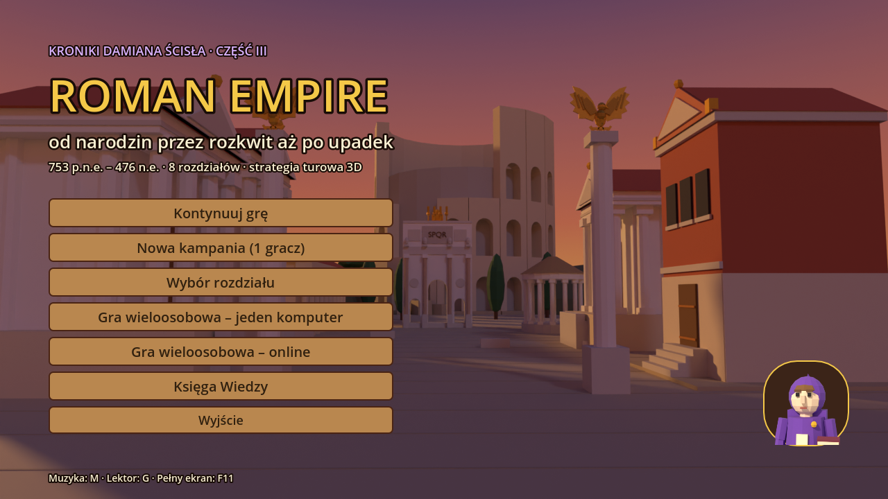
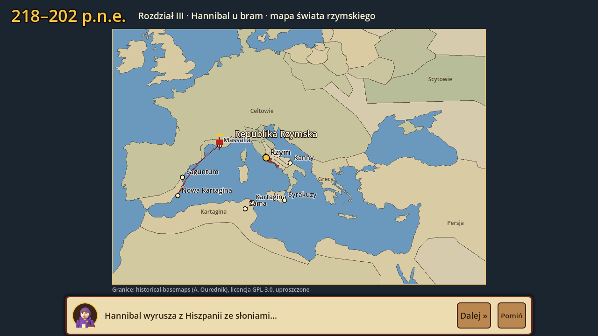
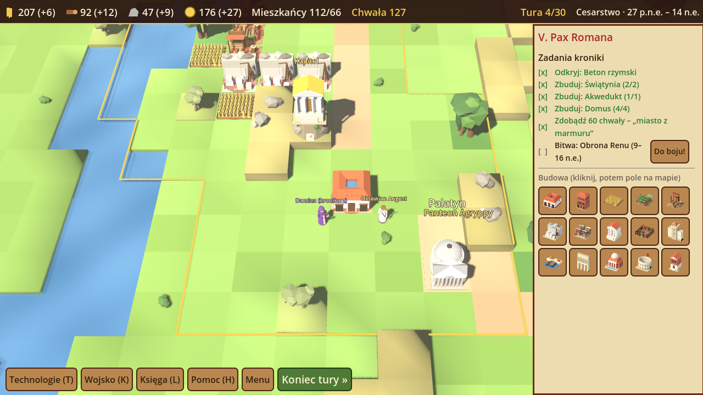
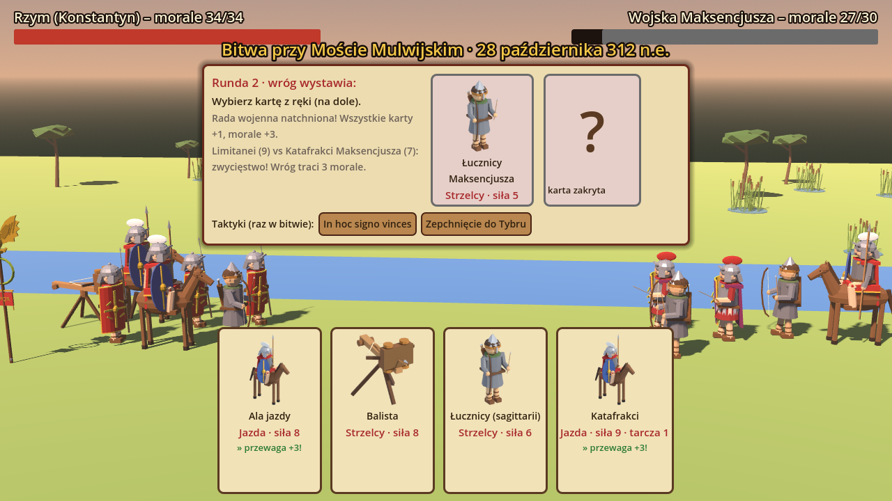
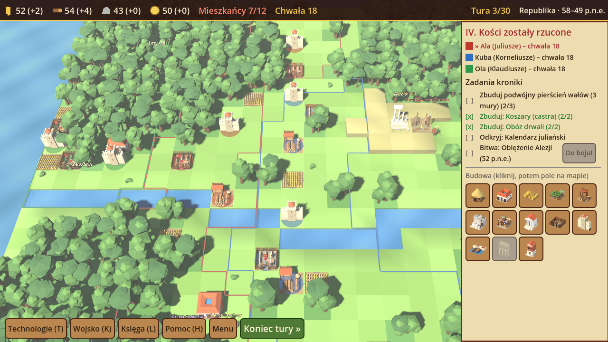

# Roman Empire — od narodzin przez rozkwit aż po upadek

**Kroniki Damiana Ścisła, część III.** Edukacyjna strategia turowa 3D o starożytnym Rzymie (753 p.n.e. – 476 n.e.)
dla uczniów w wieku **10–14 lat**, po polsku. Modele: **Blender** (skrypt Pythona), silnik: **Godot 4.3**.
Gra działa **w przeglądarce** (eksport HTML5) i jako **`RomanEmpire3D.exe`** na Windows.

- **Rozgrywka jak w „Kronikach Damiana Ścisła”**: mapa z kafli, tury, 4 zasoby (zboże, drewno, kamień, denary),
  budynki poszerzające granice, technologie zdobywane zagadką, bitwy kartami z pytaniem rady wojennej, zagony
  wroga z obozów, kronikarz Damian w fioletowym płaszczu jako doradca, lektor.
- **Mapy jak w „Roman Dmowski. Droga do Wersalu 3D”**: przed każdym rozdziałem animowana mapa basenu Morza
  Śródziemnego z prawdziwymi granicami epoki (historical-basemaps), trasą wyprawy (legion lądem, galera morzem)
  i przejściem granic, np. od Republiki 200 p.n.e. do imperium Trajana.
- **Tryb wieloosobowy**: 2–4 graczy jako rody (Juliusze, Korneliusze, Klaudiusze, Fabiusze) – przy jednym komputerze
  albo **online** (pokoje z 4-literowym kodem).







## Rozdziały

| # | Lata | Epoka | Rozdział | Zadania i bitwa |
|---|------|-------|----------|-----------------|
| I | 753 p.n.e. | Królestwo | Wilczyca i pług (Palatyn) | chaty, pola, mury, Cloaca Maxima · wojna z Sabinami (legenda) |
| II | 509–390 p.n.e. | Republika | Gęsi Kapitolu | Prawo XII tablic, targ, świątynia, mury · obrona Kapitolu przed Galami Brennusa |
| III | 264–202 p.n.e. | Republika | Hannibal u bram | port, corvus, legion manipularny, zapasy · bitwa pod Zamą (słonie!) |
| IV | 58–49 p.n.e. | Republika | Kości zostały rzucone | wały, koszary, kalendarz juliański · oblężenie Alezji |
| V | 27 p.n.e.–14 n.e. | Cesarstwo | Pax Romana | beton, świątynie, akwedukt, „miasto z marmuru” · obrona Renu po klęsce Warusa |
| VI | 80–117 n.e. | Cesarstwo | Rozkwit imperium | testudo, amfiteatr, hypokaustum · zdobycie Sarmizegetusy (Dacja) |
| VII | 284–330 n.e. | Późne cesarstwo | Pod tym znakiem zwyciężysz | tetrarchia, solidus (koniec inflacji), edykt mediolański, bazylika · Most Mulwijski |
| VIII | 376–476 n.e. | Późne cesarstwo | Zmierzch Zachodu | federaci, limes, mury · Pola Katalaunijskie; finał: rok 476 i dziedzictwo Rzymu |

## Mechaniki

- **17 budynków** (chata, domus, insula, pole, winnica, obóz drwali, kamieniołom, targ, świątynia, koszary, mury, port,
  akwedukt, termy, amfiteatr, kuria, bazylika) z wymaganiami terenu (pole nad rzeką daje więcej, kamieniołom na
  wzgórzu, port nad wodą). Każdy kolejny budynek tego samego typu kosztuje o 25% więcej.
- **Mieszkańcy** obsługują budynki – gdy ich brakuje, produkcja spada; mieszkańcy i wojsko jedzą zboże.
- **20 technologii** z zagadkami i ciekawostkami (alfabet, Cloaca Maxima, Prawo XII tablic, łuk, corvus, reforma Mariusza,
  kalendarz juliański, beton, hypokaustum, testudo, limes, prawo rzymskie, solidus, edykt mediolański…).
- **Bitwy kartami** w 3D: pytanie rady wojennej (60 pytań z 4 epok), potem rundy – piechota ▸ jazda ▸ strzelcy ▸ piechota
  (+3 za przewagę), 43 karty (hastati, triarii, legioniści, balista, katafrakci… oraz Galowie, słonie Hannibala,
  Germanie, Dakowie, Hunowie), dowódca rozdziału i **taktyki historyczne** (Gęsi Junony, korytarze dla słoni pod Zamą,
  podwójny wał Alezji, „In hoc signo vinces”, szarża Wizygotów).
- **Zagony wroga** z obozów palą budynki; mury chronią, zagon można przechwycić.
- **15 wydarzeń-dylematów** z komentarzem „co było naprawdę” (secesja plebejuszy, Kanny i Fabiusz Zwlekający,
  Grakchowie, Rubikon, klęska Warusa, chleba i igrzysk, **psucie monety i inflacja**, edykt mediolański, Goci nad Dunajem,
  podział cesarstwa) oraz zdarzenia losowe z lekcjami ekonomii.
- **Księga Wiedzy**: 49 haseł, 14 postaci z portretami z Blendera, oś czasu; ukryte **pamiątki** na mapach
  (denar, amfora, bulla, bursztyn znad Bałtyku – szlak bursztynowy i Calisia).
- **Chwała** jako wynik, gwiazdki za tempo, tytuł honorowy na koniec kampanii; zapis gry w każdej chwili.

## Gra wieloosobowa

- **Jeden komputer**: Menu → „Gra wieloosobowa – jeden komputer”, 2–4 graczy, wybór rozdziału. Gracze grają po kolei,
  ekran przekazania tury chroni przed podglądaniem. Wygrywa ród z największą chwałą; pierwsze zwycięstwo w bitwie
  rozdziału daje +10 i kończy grę po tej rundzie (albo limit tur).
- **Online**: jeden gracz zakłada pokój i podaje kod, reszta dołącza. Gracz w turze wysyła stan gry do pozostałych,
  którzy widzą jego ruchy na żywo; czat w prawym panelu. Rozłączony gracz jest pomijany (jego turę kończy gospodarz).
- **Serwer** to ten sam projekt Godota: `godot --headless --path godot -- --serwer 9080` albo przycisk
  „Uruchom serwer na tym komputerze” w wersji EXE (gra w sieci lokalnej: `ws://IP-komputera:9080`).
  Wersja w przeglądarce ze strony https potrzebuje adresu **wss://** – serwer za odwrotnym proxy z certyfikatem lub na
  hostingu z TLS; gotowy obraz: `serwer/Dockerfile`.

## Jak uruchomić i zbudować

- **Przeglądarka:** po scaleniu z `main` strona GitHub Pages publikuje grę pod `…/gry-historyczne/rzym3d/graj/`;
  workflow `rzym3d-exe.yml` buduje ją też przy każdym pushu (artefakt *RomanEmpire3D-przegladarka*).
- **Windows:** artefakt *RomanEmpire3D-Windows* z workflowu `rzym3d-exe.yml` → `RomanEmpire3D.exe`.
- **Godot 4.3+:** *Importuj* → `rzym3d/godot/project.godot` → F5.

Polecenia (z katalogu `rzym3d`) – pełny opis w `AGENTS.md`:

```bash
python narzedzia/dane.py                         # treść gry -> godot/dane/dane.json (+ walidacja map i celów)
python narzedzia/eksportuj_mape.py               # mapy imperium (pip install shapely)
python narzedzia/generuj_dzwieki.py              # efekty i 6 motywów muzycznych (numpy)
python narzedzia/generuj_lektora.py              # lektor Piper (w GitHub Actions)
blender -b -P blender/generuj_modele.py          # modele .glb, portrety, karty, ikony, tła
godot --headless --path godot -- --samotest      # autotest: 8 rozdziałów, 8 bitew, hot-seat, zapis, sieć
godot --path godot -- --zrzuty ../zrzuty         # zrzuty ekranu
```

Sterowanie: mysz (LPM – budowa/wybór, PPM – przesuwanie, kółko – zoom), WASD/strzałki, Q/E – obrót, C – siedziba,
Spacja – koniec tury, T – technologie, K – wojsko, L – Księga, H – pomoc, M – muzyka, G – lektor, F11 – pełny ekran.

Granice na mapach: projekt [historical-basemaps](https://github.com/aourednik/historical-basemaps) (A. Ourednik),
licencja GPL-3.0 (`godot/dane/LICENSE-mapa-imperium-GPL3.txt`). Legendy (wilczyca, Sabinki, gęsi kapitolińskie)
gra wyraźnie oznacza jako legendy.
