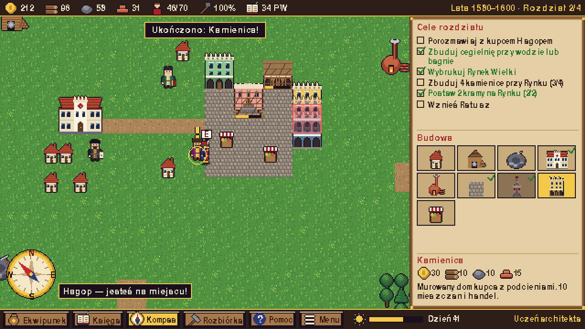

# Jan Zamoyski i Miasto Idealne

Edukacyjna gra strategiczna (budowanie miasta) w stylu **pixel art 16-bit** dla dzieci w wieku **10–12 lat**.
Silnik: **Python + Pygame (pygame-ce)**. Język: polski. Platforma docelowa: **Windows 11 (.exe)**.



## Fabuła — 4 rozdziały w Zamościu

Bohater: **Jan Zamoyski** — szlachcic, kanclerz i hetman, w kołpaku z piórem czapli, z nieodłącznym **kompasem**.
Misja: zbudować renesansowe „miasto idealne”.

| Rozdział | Lata | Cele |
|---|---|---|
| I. Kompas i plan | 1580 | rozmowa z Morando, tartak, kamieniołom, 4 domy, Pałac Zamoyskich |
| II. Rynek Wielki | 1580–1600 | rozmowa z Hagopem, cegielnia, Rynek, 4 kamienice przy Rynku, 2 kramy, Ratusz |
| III. Akademia i Kolegiata | 1587–1600 | rozmowa z Szymonowicem, Kolegiata, Akademia Zamojska, 75 Punktów Wiedzy |
| IV. Twierdza nie do zdobycia | 1587–1605 | rozmowa z Morando, 7 bastionów, 3 bramy (Lubelska, Lwowska, Szczebrzeska) |

**Postacie poboczne:** Bernardo Morando (architekt z Padwy), Szymon Szymonowic (poeta, współtwórca Akademii),
Hagop (kupiec ormiański — postać fikcyjna, przedstawiająca ormiańskich kupców osiedlających się w Zamościu od 1585 r.).

## Mechaniki

- **Strategia ekonomiczna** — 4 surowce (złoto, drewno, kamień, cegła), mieszczanie płacą podatki,
  warsztaty potrzebują robotników, warunki terenowe (tartak przy lesie, kamieniołom przy skałach,
  cegielnia przy wodzie/bagnie, kram na bruku Rynku), czas budowy, rozbiórka.
- **Ekwipunek** — 10 przedmiotów z opisami i działaniem: kompas, sakiewka, kosz z prowiantem, plan Morando,
  przywilej lokacyjny, waga kupiecka, cyrkiel, gęsie pióro, Księga Akademii, klucze do bram.
- **Kompas (K)** — igła wskazuje kierunek do bieżącego celu, podaje stronę świata i odległość,
  podświetla złote działki z planu Morando.
- **System wiedzy (PW)** — Punkty Wiedzy za zagadki postaci, czytanie 20 kart Księgi Wiedzy i budowę zabytków;
  PW odblokowują Kolegiatę i Akademię oraz rangi (Giermek → Mecenas Renesansu).
- **Zapis gry** — automatycznie na początku każdego rozdziału (`%APPDATA%\ZamoscGra\zapis.json`).

## Treści edukacyjne (architektura i historia)

Renesans, miasto idealne i antropomorficzny plan Zamościa, przywilej lokacyjny z 1580 r., prawo magdeburskie,
Rynek Wielki 100 × 100 m, ratusz z wieżą 52 m i wachlarzowymi schodami, podcienia i attyki, wielokulturowość
(Ormianie, Żydzi sefardyjscy, Grecy, Włosi, Szkoci), Kolegiata, Akademia Zamojska (1594), fortyfikacja bastionowa,
obrona z 1648 i 1656 r., wpis na listę UNESCO (1992), strony świata i kompas.

## Sterowanie

| Klawisz | Akcja |
|---|---|
| Strzałki / WASD | chodzenie |
| E / Spacja | rozmowa z postacią |
| Mysz (LPM / PPM) | stawianie budynku / anulowanie |
| K / I / L / H | kompas / ekwipunek / Księga Wiedzy / pomoc |
| M / F11 / Esc | muzyka / pełny ekran / menu |

## Uruchomienie i kompilacja

```bash
pip install -r requirements.txt
python main.py
```

**Plik EXE dla Windows 11:** na Windows uruchom `zbuduj_exe.bat` → powstanie `dist\ZamoyskiMiastoIdealne.exe`
(jeden plik, wszystkie grafiki i dźwięki w środku). EXE buduje też automatycznie workflow GitHub Actions
`.github/workflows/zamosc-exe.yml` — gotowy plik jest w artefaktach przebiegu (*ZamoyskiMiastoIdealne-Windows*).

## Zasoby

Wszystkie grafiki (kafelki, budynki, sprite'y postaci w 3 kierunkach z animacją chodu, portrety, ikony,
ramki UI, róża wiatrów, 6 teł) i dźwięki (muzyka — galiarda na „lutni” z algorytmu Karplusa-Stronga,
11 efektów) są generowane kodem: `python narzedzia/generuj_zasoby.py`.

`python main.py --zrzuty KATALOG` zapisuje automatyczne zrzuty ekranu (katalog `zrzuty/`).
