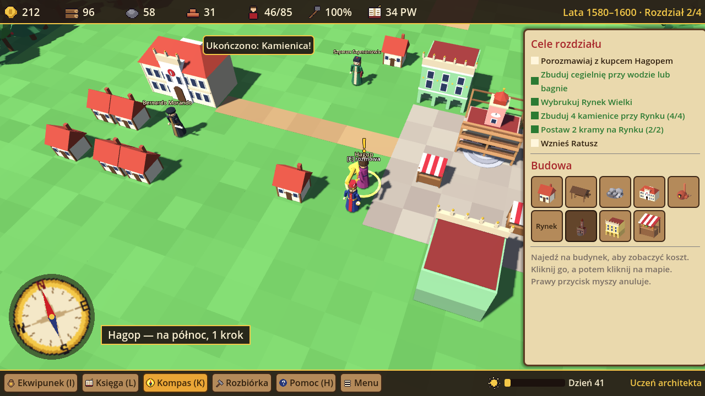

# Jan Zamoyski i Miasto Idealne 3D

Trójwymiarowa wersja gry strategicznej o budowie renesansowego Zamościa (wersja 2D: `../zamosc/`).
Dla dzieci w wieku **10–12 lat**, język **polski**. Modele: **Blender**, silnik: **Godot 4.3**,
plik wynikowy: **`ZamoyskiMiastoIdealne3D.exe`** dla Windows 10/11.

## Co jest w grze

- Ta sama fabuła co w wersji 2D: **4 rozdziały (1580–1605)**, postacie: Bernardo Morando, Szymon Szymonowic
  i Hagop (kupiec ormiański — postać fikcyjna), 18 zagadek, **20 kart Księgi Wiedzy**, 10 przedmiotów w **ekwipunku**,
  **Punkty Wiedzy** i rangi.
- Świat 3D: mapa 40 × 26 pól z rzeką, bagnami, lasem i traktami. Chodzisz Janem Zamoyskim, obracasz i przybliżasz
  kamerę, stawiasz budynki z podglądem (zielony = można, czerwony = nie). Budowy rosną na rusztowaniach.
  Wały twierdzy łączą gotowe bastiony, a bramy i kamienice ustawiają się frontem we właściwą stronę.
- **Kompas (K)**: złota strzałka nad bohaterem, pierścień w miejscu celu, róża wiatrów obracająca się razem
  z kamerą i podpis typu „Ratusz — na północny wschód, 6 kroków”. Pokazuje też działki z planu Morando.
- Portrety postaci, miniatury budynków i tło tytułowe są wyrenderowane w Blenderze (Cycles).

## Sterowanie

| Klawisz | Akcja |
|---|---|
| WASD / strzałki | chodzenie |
| Q / R, prawy przycisk myszy (przeciąganie) | obrót kamery |
| kółko myszy | przybliżanie / oddalanie |
| E / Spacja | rozmowa z postacią |
| LPM / PPM | postaw budynek / anuluj |
| K / I / L / H | kompas / ekwipunek / Księga Wiedzy / pomoc |
| M / F11 / Esc | muzyka / pełny ekran / menu |

## Jak otworzyć u siebie (Blender, Godot, Antigravity)

1. **Blender** (4.0 lub nowszy) — modele są już wygenerowane w `godot/modele/`. Żeby je zmienić, edytuj
   `blender/generuj_modele.py` i uruchom w terminalu w folderze `zamosc3d`:
   `blender -b -P blender/generuj_modele.py`
   (albo otwórz skrypt w Blenderze: zakładka *Scripting* → *Open* → *Run Script*).
2. **Godot 4.3** (lub nowszy 4.x) — *Import* → wskaż `zamosc3d/godot/project.godot` → F5 uruchamia grę.
   EXE: *Projekt → Eksportuj… → Windows* (Godot poprosi o pobranie szablonów eksportu).
3. **Antigravity** — otwórz folder `zamosc3d` jako projekt. Plik `AGENTS.md` opisuje strukturę, polecenia
   i zasady, więc agent może od razu rozbudowywać grę (np. „dodaj nowy budynek: studnię na Rynku”).

Treść gry (fabuła, zagadki, Księga) jest wspólna z wersją 2D: po zmianie `../zamosc/dane.py` uruchom
`python narzedzia/eksportuj_dane.py`.

## Testy i budowanie

- `godot --headless --path godot -- --samotest` — automatyczne przejście wszystkich 4 rozdziałów (`TEST_WYNIK: OK`).
- `godot --path godot -- --zrzuty KATALOG` — 11 zrzutów ekranu (katalog `zrzuty/`).
- Workflow `.github/workflows/zamosc3d-exe.yml` buduje EXE dla Windows, uruchamia autotest i robi zrzuty;
  gotowy plik jest w artefaktach przebiegu (*ZamoyskiMiastoIdealne3D-Windows*).
